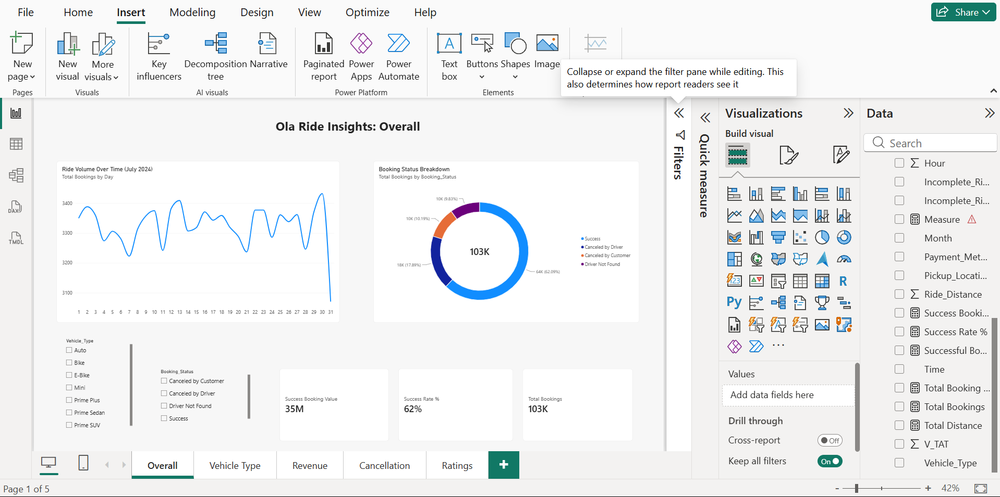
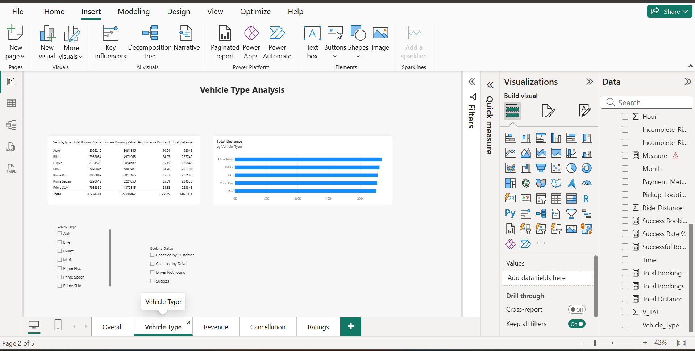
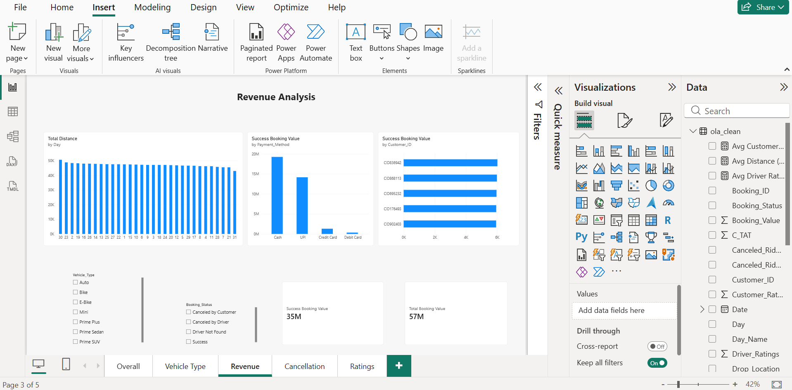
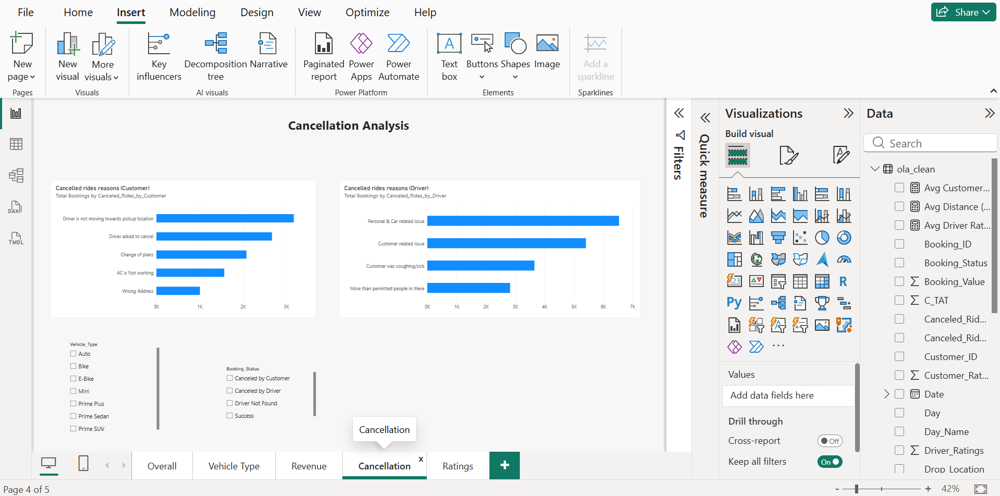
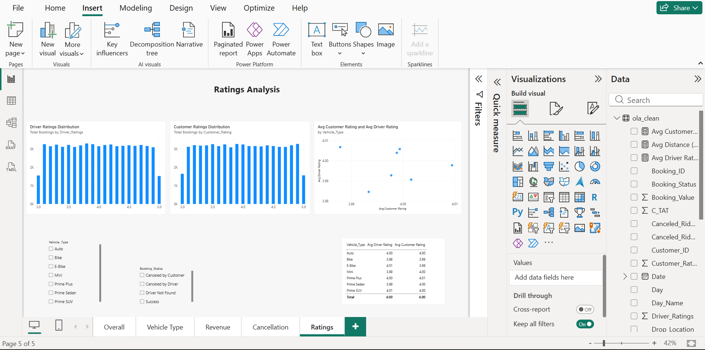

# Ola Ride Insights
**Live app:** https://aapka-app-link.streamlit.app
Ride-sharing analytics on Ola's July 2024 bookings: data cleaning (Python), SQL analysis (MySQL), an interactive
Power BI dashboard and a Streamlit app.

**Dataset:** 103,024 bookings, 23 columns after cleaning (`ola_clean.csv`). Skills: Python, pandas, SQL, Power BI, Streamlit.

## Project structure
| File | Purpose |
|---|---|
| `ola_cleaning.py` | Cleans `OLA_DataSet.xlsx` and writes `ola_clean.csv` |
| `load_to_mysql.py` / `load_data.bat` | Loads the CSV into MySQL (`ola.ola_rides`) |
| `ola_sql_queries.sql` | The 10 SQL queries |
| `streamlit_app.py` | Streamlit app: filters, charts, SQL results, Power BI embed |
| `POWER_BI_GUIDE.md` | DAX measures and visual-by-visual build guide |
| `OLA project.pbix` | Power BI dashboard (5 pages: Overall, Vehicle Type, Revenue, Cancellation, Ratings) |
| `dashboard_*.png` | Screenshots of each dashboard page |
| `screenshot/` | MySQL Workbench screenshots of the 10 SQL queries, numbered (1) to (10) in query order |
| `docs/Ola-Slides-filled.pptx` | Dashboard background slides with summary numbers |

## How to run
1. **Clean data:** `python ola_cleaning.py` (or use the provided `ola_clean.csv`).
2. **MySQL:** create the table `ola_rides` (see the SQL header), then run `load_data.bat` or `python load_to_mysql.py`.
3. **Queries:** open `ola_sql_queries.sql` in MySQL Workbench.
4. **App:** `pip install -r requirements.txt` then `streamlit run streamlit_app.py`.

## Data cleaning decisions
- Date converted to datetime; derived `Hour`, `Day`, `Day_Name`, `Month`.
- `eBike` renamed `E-Bike` to match the dashboard slides.
- Ratings, TAT and distance are blank/zero for cancelled rides. Ratings are kept as NULL (filling with 0 would lower averages).
- Text columns (cancellation reasons, payment method, incomplete rides) filled with `Not Applicable`; this value is excluded in reason and payment charts.
- Duplicate `Booking_ID`s dropped (none found); `Vehicle Images` column dropped.

## Power BI dashboard
Open `OLA project.pbix` in Power BI Desktop. Pages and screenshots:

## SQL results (validated)
| # | Question | Result |
|---|---|---|
| 1 | Successful bookings | 63,967 rows |
| 2 | Avg ride distance per vehicle (successful rides) | Auto 10.04 km; all other vehicles about 24.9 to 25.2 km |
| 3 | Rides cancelled by customers | 10,499 |
| 4 | Top 5 customers by rides | CID954071 (5), then CID189965, CID199017, CID201733, CID263459 (4 each) |
| 5 | Driver cancellations: personal & car issues | 6,542 |
| 6 | Prime Sedan driver rating | max 5.0, min 3.0 |
| 7 | Rides paid by UPI | 25,881 |
| 8 | Avg customer rating per vehicle | 3.99 to 4.01 for every vehicle type |
| 9 | Total booking value, successful rides | 35,080,467 |
| 10 | Incomplete rides | 3,926 (Vehicle Breakdown 1,591; Customer Demand 1,601; Other Issue 734) |

Note on Q2: cancelled rides have distance 0, so the query filters `Booking_Status = 'Success'`; without the filter averages are understated.

## Key insights
- **Only 62.1% of bookings succeed.** Driver cancellations (17.9%), customer cancellations (10.2%) and "Driver Not Found" (9.8%) account for the rest.
- **Driver-side cancellations are the biggest leak.** Top reason: personal & car related issues (6,542). Top customer-side reason: driver not moving towards pickup (3,175), followed by "driver asked to cancel" (2,670), which points to driver availability and dispatch quality.
- **Auto rides are short:** 10 km on average versus about 25 km for every other vehicle type.
- **Cash and UPI make up about 95% of successful revenue** (Cash 19.3M, UPI 14.2M; cards 1.7M combined).
- **Ratings are flat (about 4.0)** across vehicle types, so service quality does not differentiate vehicle categories.
- Demand is steady at roughly 3,300 bookings/day. Hourly volume is almost flat (4,176 to 4,408 bookings per hour of day, within about 3% of the average), so there is no sharp peak hour.

## Recommendations
1. Reduce driver cancellations with vehicle-health reminders and penalties/incentives for accepted-then-cancelled rides.
2. Fix pickup experience (ETA tracking, proximity-based allocation) to cut customer cancellations.
3. Since demand is flat across the day, "Driver Not Found" (9.8%) is a supply and allocation problem rather than a peak-hour problem: keep driver availability consistent through the day and improve matching.
4. Push UPI and cards (digital payments) to reduce cash handling.
